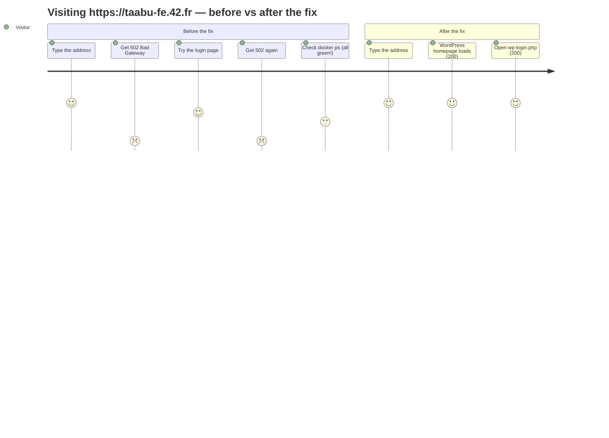
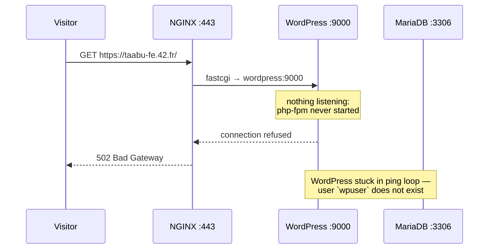
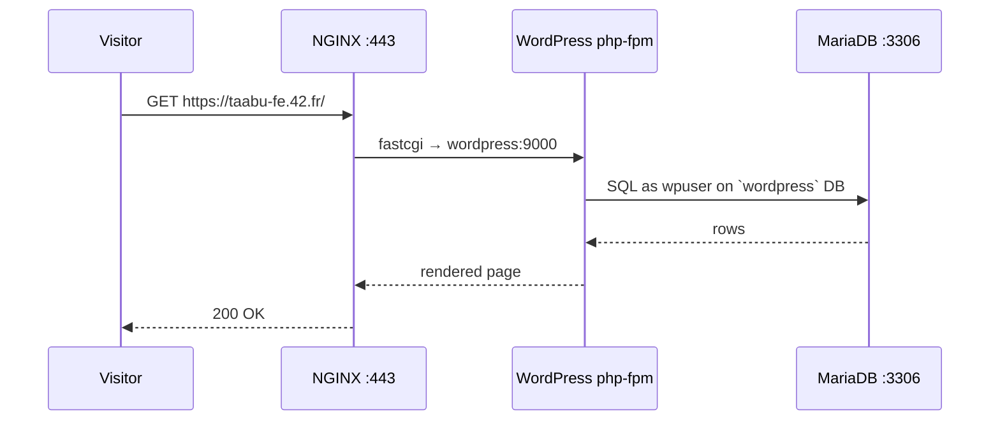
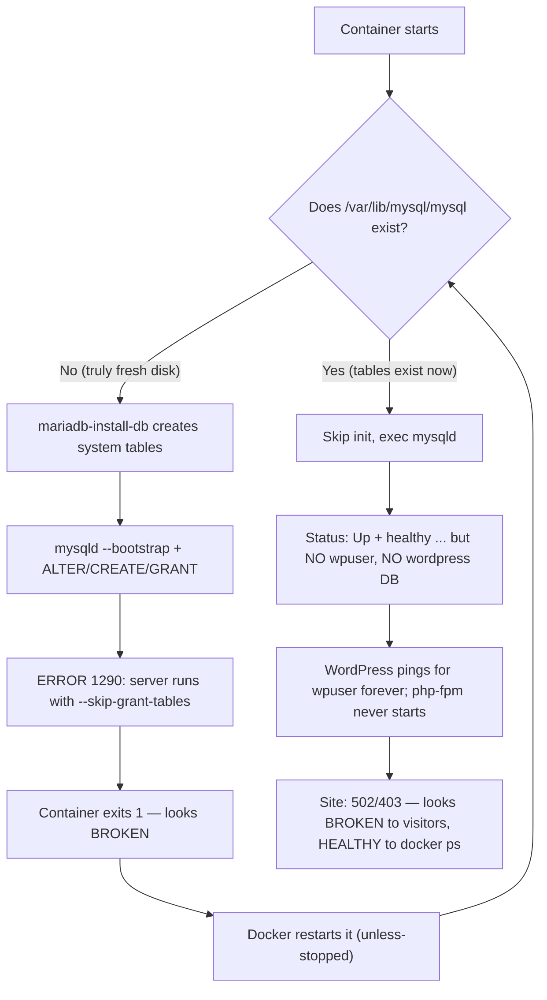
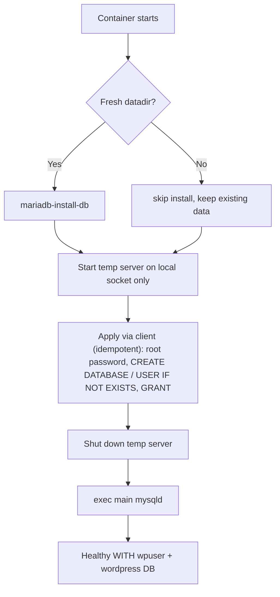

# Inception — Failure & Findings Report

Date: 2026-10-10 · Host: Debian, Docker 26.1.5 + Compose v5.5.1 · Stack: NGINX → WordPress (PHP-FPM) → MariaDB

## TL;DR

- **Grown-up version:** the stack *looked* alive (3 containers `Up`, MariaDB `healthy`, TLS answering) but the site returned **502/403** because the WordPress database user was never created. The MariaDB init script used `mysqld --bootstrap`, which on MariaDB 10.11 rejects every account statement with `ERROR 1290`, so **every fresh boot crashed** — and stale data on the host **masked the crash** on every later boot, making it look "fine before, broken on retest".
- **Kid version:** the pantry keeper followed a broken recipe, the kitchen never got its ingredients, the cook waited by the door forever, and the greeter had to tell every visitor "sorry, kitchen closed" — while all the shop lights were on. (§6 tells the whole story.)

## 1. The user journey (what a visitor experiences)

Broken request path (before):

Working request path (after):

## 2. The mystery: why did it look fine *before* but fail *on retest*?

There was never a healthy site — there was a **zombie that looked healthy**. This flowchart is the old MariaDB entrypoint; follow the loop:

Three masks hid the bug:

1. **The crash healed itself into a zombie.** Boot #1 always crashed (1290), but `mariadb-install-db` had already left system tables behind. Boot #2 saw the tables, skipped init, and reported `healthy` — with an empty-of-app-schema database.
2. **Green lights, nobody home.** `docker ps` showed `Up`, the healthcheck (root ping) passed, NGINX answered TLS handshakes. Every superficial checklist item passed while no page could ever load.
3. **The photocopier.** Wiping the host data and recreating the volume brought the *same* Oct-8 database files back: the image itself shipped a half-initialized datadir (Debian package postinst), and the volume driver copied the image layer into the "empty" bind dir. So even `fclean`-style resets resurrected the zombie — and the old `fclean` couldn't delete the host files anyway (owned by another uid → permission denied), so retests kept failing the same way.

The fixed entrypoint breaks the loop — it **guarantees the schema on every boot** instead of trusting the datadir:

## 3. All issues found

### MariaDB (critical)

| # | Issue | Impact |
|---|-------|--------|
| M1 | Init used `mysqld --bootstrap`, which runs with grant tables skipped on 10.11 → `ERROR 1290` on `ALTER/CREATE USER/GRANT` → container exit 1 on any fresh datadir | Fresh `make` can never initialize the DB |
| M2 | Image shipped a half-initialized `/var/lib/mysql` (Debian postinst); volume driver copied it into "empty" bind dirs, so the `if [ ! -d .../mysql ]` guard skipped init forever | Stale/broken state resurrected after wipes |
| M3 | `root@localhost` auth drifted (unix_socket vs secret password) depending on datadir history | Healthcheck vs app auth confusion |
| M4 | Log flooded with `Aborted connection ... unauthenticated` every second | Symptom of WordPress ping loop |

### WordPress (blocked, not broken)

| # | Issue | Impact |
|---|-------|--------|
| W1 | `until mariadb-admin ping ... wpuser` loop has no timeout/retry limit | Hangs forever instead of failing visibly; php-fpm never starts → NGINX 502 |
| W2 | `/var/www/html` left containing a foreign `index.nginx-debian.html`, WP files never copied | Symptom of W1 |

### NGINX (no defect)

| # | Finding |
|---|---------|
| N1 | TLS 1.2/1.3-only, `fastcgi_pass wordpress:9000`, `.ht` deny, `server_tokens off` all correct — 502/403 were purely downstream symptoms |

### Repo, build & host scope

| # | Issue | Impact |
|---|--------|--------|
| R1 | `srcs/.env.example` deleted from worktree while docs say `cp srcs/.env.example srcs/.env` | Setup instructions unusable on fresh clone |
| R2 | Stale duplicate `srcs/secrets/` — untracked AND not gitignored | Live DB/admin passwords one `git add .` from commit |
| R3 | `.gitignore` `secrets/*.txt` is root-anchored, didn't cover nested secrets dirs | Same leak vector |
| R4 | Docs referenced `docker-compose` v1, which isn't installed (only `docker compose` v2) | Copy-pasted commands fail |
| R5 | Makefile `data`/`certs` silently misbehaved without `srcs/.env`; `fclean` never removed host-backed data dirs and failed with permission denied on container-owned files | Stale datadir survived resets; `fclean` exited non-zero |
| R6 | Images tagged `mariadb:latest`, `wordpress:latest`, `nginx:latest` — shadowing official Hub tags host-wide | Our build overwrites (or impersonates) any other setup's upstream images; plus dangling `<none>` images from rebuilds |
| R7 | Static network name `inception` is shared with any other project using that name | Noted caveat; kept (subject convention), volumes already use `inception_*` names |
| R8 | `srcs/certs/` had no `.gitkeep` | Fresh clone lacks the read-only cert mount dir |

Environment quirk (not a repo bug): `docker kill wordpress` does not auto-restart on this host's Docker 26.1.5 (`RestartCount` stayed 0). The `unless-stopped` policy config is correct, and since the entrypoint `exec`s php-fpm as PID 1, a real php-fpm crash exits the container and the policy applies.

## 4. Fixes applied (issue → fix → file)

| Issues | Fix | File(s) |
|---|---|---|
| M1, M3 | Rewrote init: temp local server + client-applied **idempotent** SQL (root pw, DB, user, grants), with password/socket auth fallback | `srcs/requirements/mariadb/tools/entrypoint.sh` |
| M2 | Delete baked datadir at build time | `srcs/requirements/mariadb/Dockerfile` (`rm -rf /var/lib/mysql/*`) |
| R1 | Restored `srcs/.env.example` (byte-identical to HEAD) | `srcs/.env.example` |
| R2, R3 | Removed `srcs/secrets/`; ignore `srcs/secrets/*.txt` too | `srcs/secrets/` (deleted), `.gitignore` |
| R4 | `docker-compose` → `docker compose` | `DEV_DOC.md`, `USER_DOC.md`, `GUIDELINE_TESTING.md` |
| R5 | `.env` guards on `data`/`fclean`; `fclean` also removes host data dirs, with container-based fallback for other-uid-owned files | `Makefile` |
| R6 | Namespaced images: `inception-mariadb`, `inception-wordpress`, `inception-nginx` | `srcs/docker-compose.yml`, `GUIDELINE_TESTING.md` |
| R8 | Added cert dir placeholder | `srcs/certs/.gitkeep` |

Deliberately unchanged: WordPress/NGINX entrypoints and configs, compose topology/ports/policies (all correct once the DB exists).

## 5. Verification

Passed: `secrets`/`certs`/`data` idempotent (checksums unchanged, `600` perms) · `build`/`up`/`ps`/`logs`/`restart`/`down`/`clean` · site `200` on `/` and `/wp-login.php` · `wp core is-installed` OK · TLS 1.0/1.1 rejected, 1.2/1.3 accepted · `unless-stopped` on all three · only `:443` published · `down`/`up` persistence (still installed, still 200, 0 MariaDB errors) · foreign container/volume/network untouched by all targets · stale datadir self-healed without wipe (`wpuser` + DB created on pre-existing data).

Still to do at time of writing: end-to-end `fclean` → `make` fresh-path run, removal of the old shadowing image tags (`mariadb/wordpress/nginx:latest`), teardown of the `other-*` coexistence dummies. Stack was left stopped after `down`/`clean` target tests.

## 6. The whole story for a 7-year-old

Imagine three friends running a little restaurant:

- **Nora** stands at the door and greets visitors (that's NGINX).
- **Wendy** is the cook (that's WordPress).
- **Mary** keeps the pantry with all the ingredients (that's MariaDB).

**The broken recipe.** Mary's recipe card said: *"Step 1: build shelves. Step 2: whisper the magic shopping list to the shelves while wearing earmuffs."* But with earmuffs on, the shelves can't hear shopping lists at all! So on opening day, Mary shouted the list, the shelves heard nothing, and Mary fainted (the container crashed).

**The trick that fooled everyone.** When Mary woke up, she saw shelves already standing and said *"Oh, the pantry must be ready!"* — but the sugar (`wpuser`) and flour (`wordpress` database) were never put in. Wendy the cook knocked on the pantry door asking *"Is the sugar here yet?"* — once every second, forever — and never cooked a single meal. Nora at the door had to tell every visitor *"Sorry, kitchen closed"* (that's the 502 error). But the restaurant's lights were ON and the "OPEN" sign glowed (containers `Up`, database `healthy`), so grown-ups walking past thought everything was fine!

**The photocopier.** When we tried to clean the pantry and start over, a sneaky photocopier (the volume driver) kept printing copies of the OLD broken pantry back onto the "empty" shelves — because the restaurant's blueprint (the image) had a broken pantry drawn right into it.

**The name mix-up.** Our three friends wore name tags saying just "Mary", "Wendy", "Nora" — but older kids in the same school already had those exact names on their lockers (the official images on Docker Hub). Total confusion! So we gave our friends family names: "Inception-Mary" and friends.

**The fix.** We gave Mary a new recipe: *"If the shelves are missing, build them. Then open the pantry door normally (no earmuffs!), put in the sugar and flour — adding them only if they're not already there — and then start the day."* Now Wendy gets her ingredients, cooks happily, Nora seats every visitor, and nobody is fooled by the lights again. The end.
